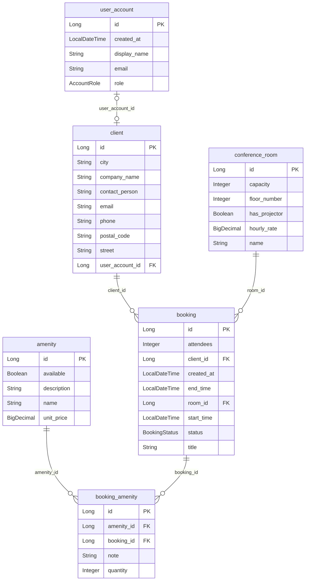

# Schemat bazy danych

Plik generują reguły projektu (panel Maven → Lifecycle → verify). Nie edytujcie go ręcznie.

Tabele: 6 · kolumny: 39 · relacje: 4 × @ManyToOne, 1 × @OneToMany, 1 × @OneToOne, 0 × @ManyToMany

| Tabela | Encja | Kolumny | Klucze obce |
|---|---|---|---|
| amenity | Amenity | 5 | — |
| booking | Booking | 9 | client_id, room_id |
| booking_amenity | BookingAmenity | 5 | amenity_id, booking_id |
| client | Client | 9 | user_account_id |
| conference_room | ConferenceRoom | 6 | — |
| user_account | UserAccount | 5 | — |

